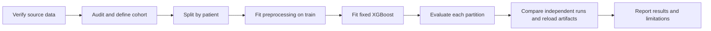

# Diabetes readmission prediction

A machine learning project investigating **recorded readmission within 30 days of discharge**, using the historical UCI Diabetes 130-US Hospitals dataset. It brings together data preparation, model comparison, a reproducible XGBoost implementation, independent verification, and a documented approach to harnessing LLMs during development.

**Historical selected-model test AP: 21.32%. Reconstructed pipeline test AP: 21.60%.** These come from different patient splits and are separate pieces of evidence. The historical comparison selected XGBoost on validation AP; the reconstruction fixes those settings without repeating model selection.

## Follow the project

| Stage | Read | Implementation and evidence |
|---|---|---|
| 1. Frame the question and prepare data | [Data preparation](docs/01_data_preparation.md) | [Cleaning notebook](01_data_cleaning.ipynb), [guided exploration](02_readmission_cleaning_and_insights.ipynb) |
| 2. Design the experiment | [Experiment design](docs/02_experiment_design.md) | [Frozen historical comparison](MODEL_RESULTS_FROZEN_2026-09-29.md), [fixed configuration](reproducibility_config.json) |
| 3. Implement the pipeline | [Implementation](docs/03_implementation.md) | [Training entry point](train.py), [reproduction contract](REPRODUCIBILITY.md) |
| 4. Evaluate and interpret | [Results and limitations](docs/04_results.md) | [Aggregate metrics](results/reconstructed_metrics.json), [independent review](review/REPORT.md) |
| 5. Explain LLM harnessing | [LLM workflow and lessons](llm_harness/README.md) | [Reusable prompts](llm_harness/prompts.md), [evidence map](llm_harness/evidence_map.md) |



## Quick start

Run commands from the repository root. The demonstrated environment is **Windows, Python 3.12.14, pinned packages, single-thread CPU**. Other environments have not been shown to produce identical values.

```powershell
python -m venv .venv
.\.venv\Scripts\python.exe -m pip install -r requirements-reproducible.txt
.\.venv\Scripts\python.exe scripts/prepare_data.py
.\.venv\Scripts\python.exe train.py --config reproducibility_config.json --output runs/my_first_run
.\.venv\Scripts\python.exe scripts/verify_pipeline.py --output runs/my_verification
```

`prepare_data.py` downloads the two original CSVs from UCI and verifies their SHA-256 values before writing. Matching local files are reused; mismatching files are rejected. The first training invocation creates the patient split and metadata sidecar. New runs require new output directories.

`verify_pipeline.py` launches two fresh training processes, compares every saved prediction and metric, checks patient separation, reloads the fitted artifacts and independently recomputes metrics. Its report describes the current invocation; the earlier **52-pass review** is retained separately in [the review report](review/REPORT.md).

For a fast source/package integrity check without installing ML dependencies:

```powershell
python scripts/check_repository.py
```

## Repository layout

```text
docs/                  Ordered walkthrough, from preparation to results
llm_harness/           LLM roles, prompt templates, failures and verification
results/               Aggregate metrics and historical review summary
scripts/               Data acquisition and portable verification
review/                Preserved original review report, policy and validator
splits/                Membership documentation; generated manifests stay local
train.py               Reviewed training implementation
reproducibility_config.json
requirements-reproducible.txt
01_*.ipynb, 02_*.ipynb  Original learning and audit notebooks
```

The reviewed source files remain at their original paths to preserve existing run provenance. Notebook outputs and execution counters are cleared in the published practice notebook to avoid publishing encounter rows; code cells are unchanged. The integrity manifest accepts the original local hash and the documented publication hash for that notebook. The numbered walkthrough is the main reading order. The notebooks show the project's development and differ in cohort rules and split stages; **`train.py` and the fixed configuration define the reconstructed experiment**. The practice notebook includes unfinished learning exercises.

Source CSVs, encounter-level predictions, patient membership, fitted binaries, local environment details and temporary exports are excluded from Git. They can be generated locally. The repository contains aggregate reporting evidence rather than patient rows or private chat transcripts.

## Status and boundaries

Implemented: offline data audit, fixed-model training, saved preprocessing/model artifacts, reproducibility checks, and aggregate reporting. LLMs assisted development and review; no LLM is used to score patient encounters. An inference application, deployment agent, hosted API and live monitoring are proposed future work.

No operational threshold or clinical deployment has been validated. Calibration, uncertainty estimates, subgroup performance and external/temporal validation remain work to do. The historical US dataset does not establish current hospital performance.

## Data attribution

Clore, J., Cios, K., DeShazo, J., & Strack, B. (2014). *Diabetes 130-US Hospitals for Years 1999–2008* [Dataset]. UCI Machine Learning Repository. [DOI: 10.24432/C5230J](https://doi.org/10.24432/C5230J). The [UCI dataset page](https://archive.ics.uci.edu/dataset/296/diabetes+130-us+hospitals+for+years+1999-2008) provides the original files under CC BY 4.0. Dataset licensing is separate from project source code; no additional source-code license is granted here.
